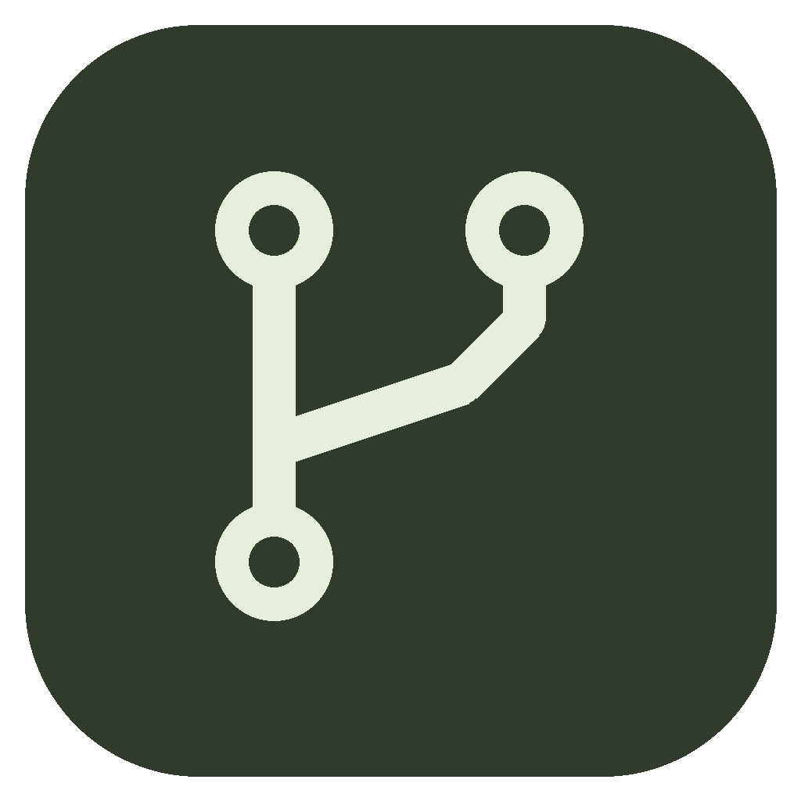
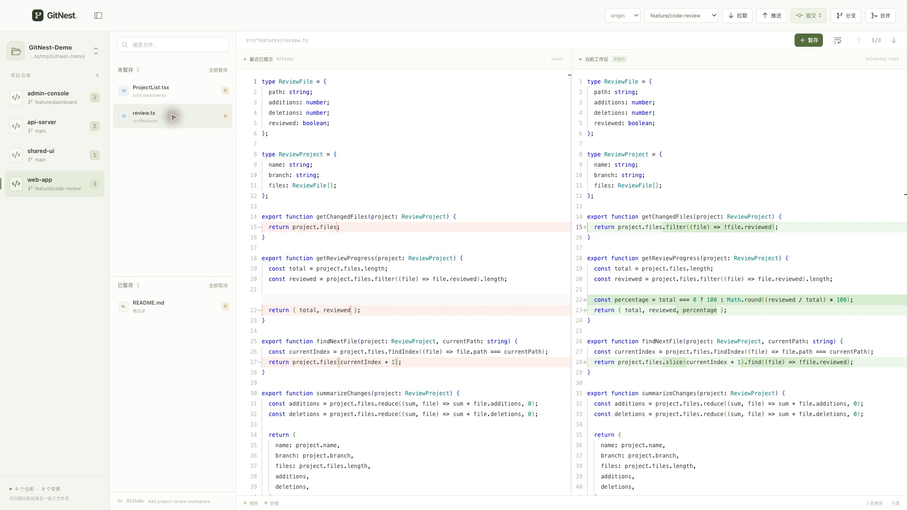
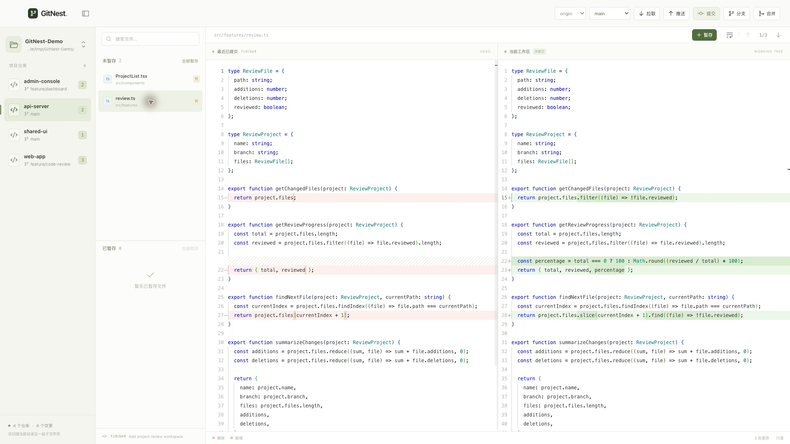

<p align="center">
  
</p>

<h3 align="center">GitNest</h3>

<p align="center">
  <strong>为 AI 时代而生的 Git 版本管理软件</strong>
</p>

## 为什么做这个工具

1. **人工 Review 效率低。** 随着 AI 生成代码的比例越来越高，人工 Review 的工作量陡增，软件可靠性也面临新的挑战。只看零散的代码变更片段，很难结合完整上下文，清晰判断究竟改得对不对。
2. **多项目管理麻烦。** 全栈工程师越来越普遍，前端、后端和其他关联项目往往分散在不同仓库中。反复打开项目、确认分支、切换仓库，让日常开发变得繁琐。

## GitNest 的优势

### 1. 文件级代码差异视图，让人工 Review 更高效

左右对照修改前后的完整文件，保留上下文；通过上下箭头在多处修改之间快速跳转。既看清改了什么，也理解这些修改与周围代码的关系。



### 2. 多项目集中展示，切换更方便

打开前后端项目共同的父文件夹，就能在一个窗口中看到多个仓库、当前分支和变更数量。点击左侧项目即可切换，继续查看差异、管理分支和提交代码。



## 如何使用

### 方式一：一键下载

在本仓库页面右侧的 **Releases** 下载适合你电脑的安装包，也可以直接前往 **[最新版本下载](https://github.com/banwotech/gitnest/releases/latest)**。

| 系统 | 选择的安装包 |
| --- | --- |
| macOS（Apple 芯片） | 名称含 `mac-arm64` 的 `.dmg` |
| macOS（Intel 芯片） | 名称含 `mac-x64` 的 `.dmg` |
| Windows（64 位） | 名称含 `win-x64` 的 `.exe` |
| Linux（64 位） | 名称含 `linux-x86_64` 的 `.AppImage` |

使用前请先安装 [Git](https://git-scm.com/downloads)。安装后打开 GitNest，选择你的项目文件夹即可；管理多个项目时，选择它们共同的父文件夹。

### 方式二：下载源码构建运行

先安装 Git 和 [Node.js 24](https://nodejs.org/)，然后执行：

```bash
git clone https://github.com/banwotech/gitnest.git
cd gitnest
npm ci
npm run build
npm start
```

开发时使用 `npm run dev`，可实时预览修改；运行 `npm run dist` 可生成当前系统的安装包。
